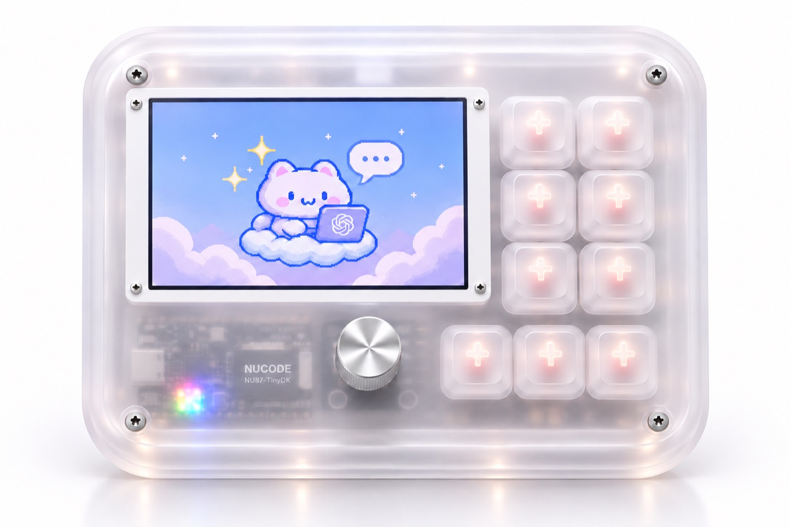

# NU87 Keyboard

[English](README.md) | **한국어**



*컨셉 렌더링 이미지입니다.*

NUCODE **NU87-TinyDK**(Realtek RTL8720DF / AMB25) 기반의 9키 매크로 패드입니다. 로터리 엔코더와 3.5인치 LCD가 달려 있고, 화면 속 픽셀아트 토끼 마스코트 **우사기(Usagi)**가 AI 도구의 상태에 따라 반응합니다. Mac에서는 작은 메뉴바 앱이 Bluetooth LE로 보드와 통신합니다.

## 주요 기능

- **9개 프로그래머블 키**: 한 번 / 두 번 / 길게 누르기 제스처 지원. Claude·Codex 실행, 복사·붙여넣기·실행취소, 스크린샷, 미디어 키, 사용자 정의 4칸을 지원합니다.
- **로터리 엔코더(KY-040)**: 메뉴 이동, ChatGPT 추론 단계, 볼륨, 밝기 조절.
- **480×320 ST7796S LCD**: 홈, 키 매핑, RGB 설정 화면과 애니메이션 우사기, 말풍선, 시계·날씨.
- **RGB 무드등**: Off, Static, Breathing, Pastel Cycle. 설정은 플래시에 저장됩니다.
- **Bluetooth LE**(Nordic UART Service)로 macOS 메뉴바 앱 **NU87 Companion**과 연결.
- **웹 에디터**: 브라우저에서 키 매핑과 설정을 편집.
- **AI 활동 표시**: Claude / Codex가 생각 중인지, 대기 중인지, 끝났는지 우사기가 보여줍니다.

## 저장소 구성

| 폴더 | 설명 |
|---|---|
| [`NU87_Usagi_LCD_Integration/`](NU87_Usagi_LCD_Integration) | 메인 펌웨어(AMB25 / RTL8720DF용 Arduino 스케치)와 에셋 생성 스크립트 |
| [`NU87_Companion/`](NU87_Companion) | macOS 메뉴바 앱(Swift): BLE 브릿지, 액션 엔진, 로컬 API |
| [`nu87-editor/`](nu87-editor) | 키 매핑·설정용 웹 에디터(React + Vite) |
| [`usagi-ascii-pet/`](usagi-ascii-pet) | 우사기 ASCII 아트 렌더러, LCD 애니메이션 헤더 내보내기 |
| [`chatgpt-bridge/`](chatgpt-bridge) | 초기 프로토타입: 엔코더/버튼으로 USB 시리얼을 통해 ChatGPT 앱 제어 |
| [`NU87_9Key_RGB_Test/`](NU87_9Key_RGB_Test) | 하드웨어 테스트: 9키 매트릭스와 RGB, 배선표 포함 |
| [`NU87_PA7_GPIO_Test/`](NU87_PA7_GPIO_Test) | 하드웨어 테스트: PA7 버튼 |

## 준비물

- NU87-TinyDK 보드(AMB25 / RTL8720DF), 3.5인치 ST7796S LCD, KY-040 엔코더, 스위치 9개. 배선은 [`NU87_9Key_RGB_Test/WIRING.md`](NU87_9Key_RGB_Test/WIRING.md)를 참고하세요.
- [`arduino-cli`](https://arduino.github.io/arduino-cli/)와 Realtek AmebaD 코어 **3.1.9**
- Companion 앱 빌드용: macOS 13 이상, Xcode 커맨드라인 도구(Swift 5.9+)
- 웹 에디터와 우사기 렌더러용 Node.js 18 이상
- Python 3 (에셋 생성 스크립트와 ChatGPT 브릿지 프로토타입에만 필요)

## 빠른 시작

### 1. 펌웨어 업로드

```bash
arduino-cli compile --fqbn realtek:AmebaD:Ameba_AMB25 NU87_Usagi_LCD_Integration
arduino-cli upload -p /dev/cu.usbserial-XXXXXXXX --fqbn realtek:AmebaD:Ameba_AMB25 NU87_Usagi_LCD_Integration
```

핀 배치, PA7 처리, 저장 방식, BLE 프로토콜 등 자세한 내용은 [`NU87_Usagi_LCD_Integration/README.md`](NU87_Usagi_LCD_Integration/README.md)에 있습니다(영문).

### 2. 웹 에디터 빌드

```bash
cd nu87-editor
npm install
npm run build
```

### 3. Companion 앱 빌드 및 실행

Companion 앱은 `nu87-editor/dist`를 `http://127.0.0.1:17871/`에서 서비스하므로, 에디터를 먼저 빌드하고 두 폴더를 같은 위치에 두세요.

```bash
cd NU87_Companion
./build.sh && open "build/NU87 Companion.app"
```

처음 실행하면 **Bluetooth**와 **손쉬운 사용(Accessibility)** 권한을 허용해야 합니다. 자세한 내용은 [`NU87_Companion/README.md`](NU87_Companion/README.md)를 참고하세요.

### 4. (선택) 우사기 애니메이션 다시 만들기

```bash
cd usagi-ascii-pet
npm install
npm run dev            # http://localhost:5199 에서 미리보기
npm run export:nu87    # ../NU87_Usagi_LCD_Integration/usagi_animation.h 생성
```

## 참고

- Companion이 사용하는 Gmail·Kakao 인증 정보는 실행 시 macOS 키체인에 저장되며, 저장소에는 비밀 정보가 포함되어 있지 않습니다.
- 빌드 결과물, 에디터 백업, 데모 영상은 의도적으로 제외했습니다.

## 라이선스

아직 라이선스를 정하지 않았습니다. 라이선스가 추가되기 전까지 모든 권리는 저작자에게 있습니다.
