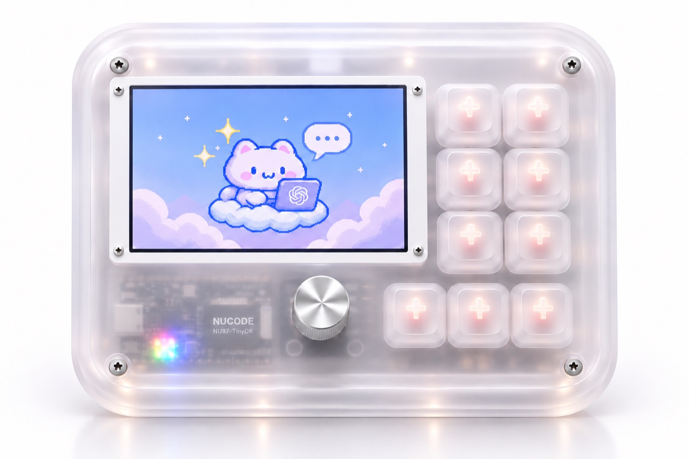

# NU87 Keyboard

**English** | [한국어](README.ko.md)



*Concept render.*

A 9-key macro pad with a rotary encoder and a 3.5" LCD, built on the NUCODE **NU87-TinyDK** (Realtek RTL8720DF / AMB25). A pixel-art rabbit mascot, **Usagi**, lives on the screen and reacts to what your AI tools are doing. The Mac side is a small menu-bar app that talks to the board over Bluetooth LE.

## Features

- **9 programmable keys** with single / double / hold gestures. Actions include launching Claude or Codex, copy / paste / undo, screenshots, media keys, and 4 custom slots.
- **Rotary encoder (KY-040)** for menu navigation, the ChatGPT reasoning level, volume and brightness.
- **480×320 ST7796S LCD** with Home, Key Mapping and RGB Settings screens, an animated Usagi, speech bubbles, a clock and weather.
- **RGB ambient lighting**: Off, Static, Breathing and Pastel Cycle, saved to flash.
- **Bluetooth LE** link (Nordic UART Service) to the **NU87 Companion** macOS menu-bar app.
- **Web editor** to remap keys and settings in the browser.
- **AI activity display**: Usagi shows when Claude / Codex is thinking, idle or done.

## Repository layout

| Folder | What it is |
|---|---|
| [`NU87_Usagi_LCD_Integration/`](NU87_Usagi_LCD_Integration) | Main firmware (Arduino sketch for AMB25 / RTL8720DF) and asset generators |
| [`NU87_Companion/`](NU87_Companion) | macOS menu-bar app (Swift): BLE bridge, action engine, local API |
| [`nu87-editor/`](nu87-editor) | Web editor for key mapping and settings (React + Vite) |
| [`usagi-ascii-pet/`](usagi-ascii-pet) | Usagi ASCII-art renderer; exports the LCD animation header |
| [`chatgpt-bridge/`](chatgpt-bridge) | Early prototype: encoder / button driving the ChatGPT app over USB serial |
| [`NU87_9Key_RGB_Test/`](NU87_9Key_RGB_Test) | Hardware test: 9-key matrix and RGB, with wiring table |
| [`NU87_PA7_GPIO_Test/`](NU87_PA7_GPIO_Test) | Hardware test: PA7 button |

## Requirements

- NU87-TinyDK board (AMB25 / RTL8720DF), a 3.5" ST7796S LCD, a KY-040 encoder and 9 switches. See the wiring in [`NU87_9Key_RGB_Test/WIRING.md`](NU87_9Key_RGB_Test/WIRING.md).
- [`arduino-cli`](https://arduino.github.io/arduino-cli/) with the Realtek AmebaD core **3.1.9**
- macOS 13+ with Xcode command line tools (Swift 5.9+) for the Companion app
- Node.js 18+ for the web editor and Usagi renderer
- Python 3 (only for the asset generators and the ChatGPT bridge prototype)

## Quick start

### 1. Flash the firmware

```bash
arduino-cli compile --fqbn realtek:AmebaD:Ameba_AMB25 NU87_Usagi_LCD_Integration
arduino-cli upload -p /dev/cu.usbserial-XXXXXXXX --fqbn realtek:AmebaD:Ameba_AMB25 NU87_Usagi_LCD_Integration
```

Details on pins, PA7 handling, persistence and the BLE protocol: [`NU87_Usagi_LCD_Integration/README.md`](NU87_Usagi_LCD_Integration/README.md).

### 2. Build the web editor

```bash
cd nu87-editor
npm install
npm run build
```

### 3. Build and run the Companion app

The Companion serves `nu87-editor/dist` at `http://127.0.0.1:17871/`, so build the editor first and keep both folders side by side.

```bash
cd NU87_Companion
./build.sh && open "build/NU87 Companion.app"
```

On first run, allow **Bluetooth** and **Accessibility**. See [`NU87_Companion/README.md`](NU87_Companion/README.md).

### 4. (Optional) Regenerate the Usagi animation

```bash
cd usagi-ascii-pet
npm install
npm run dev            # preview at http://localhost:5199
npm run export:nu87    # writes ../NU87_Usagi_LCD_Integration/usagi_animation.h
```

## Notes

- Gmail and Kakao credentials used by the Companion are stored in the macOS Keychain at runtime. Nothing secret is committed to this repo.
- Build outputs, editor backups and demo videos are intentionally not included.

## License

No license has been chosen yet. All rights reserved by the author until one is added.
